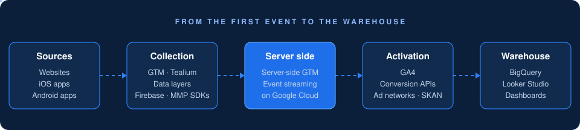
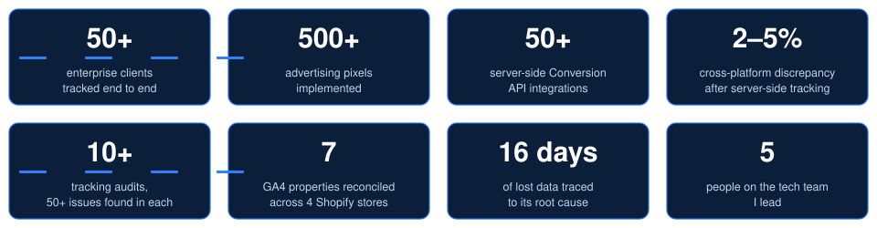

<!-- GitHub profile README, updated November 2026. The two graphics in assets/ are animated SVGs. -->

  

  

  
  

I work on the measurement side of marketing: tracking, attribution and the data pipelines behind them. As a **Data & Analytics Consultant at Merkle (dentsu)** I do this for 50+ enterprise clients with large media budgets. I also lead marketing technology and a 5-person team at **The Reel Recipe**.

## What I do

<table>
  <tr>
    <td width="33%" valign="top">
      <b>Measurement and tracking</b>
        
      GA4, Google Tag Manager and Tealium setups, data layers, server-side tagging, consent, and tracking audits that end in a fix plan.
        
      50+ enterprise clients, up to 200 tags per property
    </td>
    <td width="33%" valign="top">
      <b>Attribution</b>
        
      Conversion APIs for the ad platforms, Adjust and AppsFlyer for apps, SKAN conversion schemas, and finding where campaign credit gets lost.
        
      Gap between GA4, ad platforms and backend down to 2–5%
    </td>
    <td width="33%" valign="top">
      <b>Marketing data engineering</b>
        
      Pipelines that bring GA4, ad platform and app data into BigQuery, real-time event streaming, and the dashboards teams read every day.
        
      Site to warehouse in under a second
    </td>
  </tr>
</table>

  

## Impact

  
   
  Client names are withheld. Figures come from production data, audits and delivered work.

## Platforms

**Ad managers.** I own event tracking and measurement in these platforms: pixels, Conversion APIs, event setup and data quality, so campaigns optimize on conversions that happened.

  
  
  
  
  

**Analytics and tag management**

  
  
  
  
  
  
  
  

**Mobile attribution**

  
  
  

**Data and reporting**

  
  
  
  
  
  

## Selected work

| Engagement | Problem | Outcome |
|:--|:--|:--|
| **GCC health insurer** iOS and Android | No mobile attribution in place | Led a 4-person Adjust rollout: 7 media suppliers linked and a SKAN 4.0 conversion schema covering 25 events |
| **UAE theme park group** cross-domain booking | Purchases not credited to the campaigns that drove them | Analyzed 319 purchases, ruled out 6 suspected causes and isolated the two real ones: campaigns dropped mid-session and tagged internal links restarting sessions |
| **Multi-market retailer** 4 Shopify stores, 7 GA4 properties | GA4 showed 28% more sessions than Shopify in the UAE | The first fix removed about a third of the excess, while KSA and Kuwait stayed within 4% of Shopify |
| **Large public sector site** server-side GTM | GA4 collection silently dead | Traced 100% data loss over about 16 days to an expired TLS certificate and delivered a monitoring runbook |
| **Enterprise advertisers** server-side tagging | Ad blockers and browser limits hiding conversions | Server-side GTM with 50+ Conversion API integrations, bringing the gap between GA4, ad platforms and backend down to 2–5% |
| **Tracking audits** GA4, GTM, pixels, consent | A full audit took about a week | Built an audit workflow with 248 automated checks that ends in a ranked fix plan, designed to take an afternoon |

## Certifications

|  |  |  |  |
|:---:|:---:|:---:|:---:|
| **Google Analytics 4 Certified** | **Google Cloud Associate Data Practitioner** | **Tealium iQ Certified** | **Hotjar Certified** |

  

